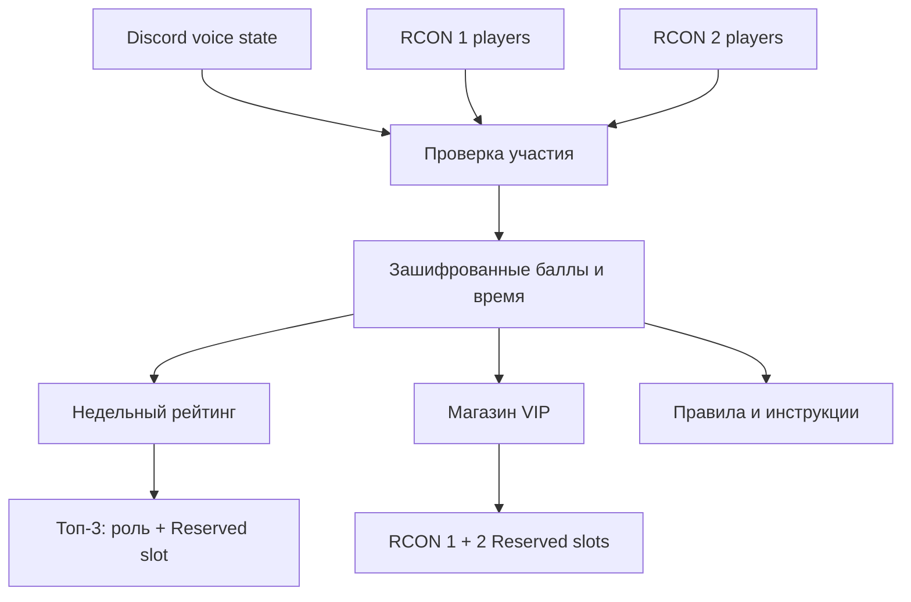

# WARDOGS Seeding Bot

В версии **1.8.1** роль `859738052666327040` и основные администраторы управляют сбором через `/seed-gather start`, `status` и `stop`. Роль сбора не получает доступ к `/seed-admin`. Инструкция — [UPDATE-1.8.1-RU.md](UPDATE-1.8.1-RU.md). Уведомление роли, обновляемая карточка, инструкция подключения и сообщение при достижении цели работают на обоих серверах отдельно; правила — [UPDATE-1.8.0-RU.md](UPDATE-1.8.0-RU.md). Новые переменные не нужны.

Отдельный Discord-бот для подтверждённого сидинга WARDOGS, подготовленный для развёртывания на **BotHost.ru**. Он не зависит от кланового бота и использует собственное Discord-приложение, токен, зашифрованную базу и резервные копии.

Сборка 1.8.1 Node20 на основе присланной версии 1.5.1 настроена под следующие вводные:

| Параметр | Значение |
|---|---|
| Discord-сервер | `403186008579112973` |
| Административные роли | `805429609457254450`, `815605974412558376` |
| Дополнительная роль только для сбора | `859738052666327040` |
| Роль «Сидер» | `1552728825568174090` |
| Роль «Супер сидер» | `1552841261713719440` |
| Роль «VIP» | `1552725871830503484` |
| Основной WDRCON | `http://51.83.166.12:7799` после подтверждения port mapping в Qonzer |
| Второй WDRCON | `http://216.144.249.92:7789`; должен поддерживать игроков, привязку и управление Reserved slots |

ID приложения Discord, токен бота, RCON-пароль и ключи шифрования намеренно не вшиты в исходники. Они задаются как закрытые значения BotHost. `http://rcon.wardogs.com` без отдельного проксируемого WDRCON-порта — публичная HTML-консоль, а не API игрового сервера, поэтому бот отклоняет такой адрес. Для прямого HTTP endpoint нужен `RCON_ALLOW_INSECURE_HTTP=true`; безопаснее использовать HTTPS и `false`, если провайдер предоставляет прямой HTTPS-прокси.

Версия 1.7.4 считает сидинг на двух серверах в общем балансе и недельном рейтинге. Порог онлайна применяется отдельно на каждом сервере, а одновременное присутствие на обоих не удваивает время. VIP за баллы, оплаченный VIP, награды топ-3 и постоянные Reserved slots предназначены для обоих серверов. Фактическая мгновенная выдача и снятие требуют, чтобы **оба WDRCON поддерживали POST и DELETE `/v1/reserved-slots`**. Если маршрутов нет, бот не пишет отложенные изменения в игровой конфиг. Для второго сервера ведётся отдельный защищённый учёт владения. Срок нового VIP за баллы начинается только после подтверждённой активации слотов на обоих серверах; при отсутствии живых маршрутов покупка отклоняется до списания баллов. Оплаченный VIP сохраняется в учёте платежей, но дату его окончания определяет сайт, даже когда игровой слот недоступен. Спонсорская роль сама по себе слот не даёт. Настройка обновления: [UPDATE-1.7.4-RU.md](UPDATE-1.7.4-RU.md).



## Что уже реализовано

- Сидинг только с 08:00 до 22:00 по Москве.
- Участник должен одновременно находиться:
  - на одном из двух игровых серверов WARDOGS;
  - в голосовом канале Discord `1552253117586739210`.
- Первые 60 минут непрерывной сессии: 1 балл каждые 6 минут.
- После первого часа: 1 балл каждые 3 минуты, то есть 20 баллов в час.
- При 20 игроках на конкретном сервере начисление там останавливается сразу. Возобновление — после 5 минут ниже порога; другой сервер продолжает работу.
- Время, баллы и непрерывная сессия общие для обоих серверов. Один Discord↔Steam аккаунт получает не больше одного интервала времени за один опрос.
- Трёхминутная техническая пауза сохраняет множитель, но время самой паузы не засчитывается.
- После перезапуска самого бота текущая непрерывная сессия начинается заново; уже начисленные баллы и время сохраняются.
- В канале `1552254053109727262` находятся две постоянные карточки: текущий недельный рейтинг и топ-3 завершившейся недели. Бот редактирует те же сообщения; старые дубликаты не создаются.
- Топ-3 завершившейся недели получает роль «Супер сидер» `1552841261713719440` и бесплатный Reserved slot на обоих серверах до следующего недельного обновления. Недельный период меняется в понедельник в 00:00 МСК.
- Постоянная карточка магазина с описаниями и кнопками покупки находится в канале `1552255043757936721`.
- Правила, подробный запуск сидинга, магазин и награды рейтинга публикуются четырьмя оформленными карточками в одном постоянном сообщении канала `1552254112060411944`.
- В канале инструкций разрешены slash-команды; обычные сообщения и сообщения сторонних ботов автоматически удаляются без чтения их содержимого.
- Зашифрованные бэкапы автоматически отправляются в закрытый канал `1552401803184701502`.
- HMAC-digest журналов аудита и баллов отправляется в закрытый канал `1552402077068820611`.
- Награды магазина:

| Награда | Цена |
|---|---:|
| VIP на 1 день | 120 баллов |
| VIP на 7 дней | 360 баллов |
| VIP на 30 дней | 760 баллов |

- После подтверждения Steam бот выдаёт роль «Сидер» `1552728825568174090`; после отвязки снимает её.
- При покупке VIP бот выдаёт роль «VIP» `1552725871830503484` и синхронизирует Reserved slot через оба WDRCON. После завершения VIP роль снимается, бот удаляет только свои слоты.
- Администратор может выдать постоянный Reserved slot и занести его в зашифрованный защищённый реестр. VIP и недельные награды никогда не удаляют такой слот, даже если временная и постоянная привилегии совпали у одного игрока.
- Все изменения Reserved slots выполняются последовательно. Если автоматическое удаление уже ожидало выполнения, более поздняя команда защиты добавит слот обратно и останется последней операцией.
- Безопасная привязка Discord↔Steam для сидеров и оплаченного VIP работает на обоих серверах: одноразовый код приходит личным whisper-сообщением внутри игры.
- Администратор может восстановить пропущенное время командой `/seed-admin time-add`; текущая неделя, общий стаж и баллы обновляются вместе, причина записывается в защищённый журнал.
- Администратор может начислить баллы или восстановить время сразу всем действующим сидерам командами `points-all` и `time-add-all`. Отдельные VIP-привязки и архивные аккаунты исключены. Массовое время также начисляет баллы по правилам ручного восстановления.
- Самостоятельная отмена привязки без удаления баллов и истории. Повторное автоматическое восстановление допускается только для той же пары Discord↔Steam; это не даёт перенести накопления на чужой аккаунт.
- Зашифрованная SQLite-база, HMAC-журнал баллов, журнал аудита, зашифрованные ежедневные бэкапы.
- Один активный экземпляр: блокировка в БД не позволяет двум копиям одновременно начислять баллы.

## Команды участников

| Команда | Назначение |
|---|---|
| `/seed link steam_id` | Начать привязку, находясь на одном из двух серверов |
| `/seed verify code` | Подтвердить код из игры |
| `/seed unlink confirm:true` | Отменить привязку; при активном/ожидающем VIP операция блокируется |
| `/seed status` | Баланс, время, VIP и фактическое состояние слотов обоих серверов на момент запроса |
| `/seed top` | Текущий топ недели |
| `/seed shop` | Магазин VIP |
| `/seed buy plan` | Покупка VIP |
| `/seed help` | Краткие правила |

## Команды администрации

| Команда | Назначение |
|---|---|
| `/seed-admin health` | Проверка Discord, обоих RCON, базы и режима VIP |
| `/seed-admin seeders [page]` | Закрытый постраничный список сидеров, времени, баланса и VIP |
| `/seed-admin points user amount reason` | Аудируемая корректировка баланса |
| `/seed-admin time-add user minutes reason` | Добавить пропущенное время в текущую неделю, общий стаж и баланс с записью в журнал |
| `/seed-admin points-all amount reason operation_id confirm` | Начислить одинаковое число баллов каждому действующему сидеру |
| `/seed-admin time-add-all minutes reason operation_id confirm` | Добавить всем время текущей недели и соответствующие баллы |
| `/seed-admin vip-sync` | Немедленная синхронизация reserved slots |
| `/seed-admin report` | Обновление обеих карточек, топ-3, ролей и недельных Reserved slots |
| `/seed-admin reserved-protect user` | Выдать/подтвердить постоянный Reserved slot и защитить его от автоматического удаления |
| `/seed-admin reserved-unprotect user` | Снять защиту; сама команда слот не удаляет |
| `/seed-admin reserved-protected [page]` | Закрытый список всех защищённых постоянных слотов |
| `/seed-admin backup` | Создание зашифрованного бэкапа |

Административные команды требуют одновременно права Discord **Manage Server** и одну из ролей, перечисленных в `DISCORD_ADMIN_ROLE_IDS`. Ответ со списком сидеров виден только вызвавшему администратору.

Исключение выделено в отдельную команду `/seed-gather start/status/stop`: роль `859738052666327040` может создавать, проверять и останавливать сбор без Manage Server. Эта роль не включена в список полных администраторов. Прежние `/seed-admin gather`, `gather-status`, `gather-stop` сохранены для основных администраторов; данные сбора общие для обеих групп команд.

Массовые команды принимают `confirm:false` для просмотра числа получателей и `confirm:true` для начисления. Для одной операции используйте один и тот же `operation_id` из латинских букв, цифр, `_` и `-` (3–64 символа). Повтор с тем же ID не выдаст награду второй раз. Начисление баллов меняет баланс, но не время и недельный рейтинг; начисление времени меняет также общий стаж, неделю и заработанные за это время баллы.

В этой сборке разрешены роли `805429609457254450` и `815605974412558376`. Достаточно любой одной из них, но проверка **Manage Server** остаётся обязательной.

## Важная особенность VIP

Бот использует только живые `POST /v1/reserved-slots` и `DELETE /v1/reserved-slots/{steamId}` и сразу перечитывает `GET /v1/reserved-slots`. Он не выполняет `PUT /v1/config` ради слотов. При отсутствии этих маршрутов на любом из серверов выдача в реальном времени невозможна: VIP за баллы не продаётся, уже оплаченные права остаются в очереди синхронизации, а ежедневный рестарт не считается решением требования мгновенной выдачи. `/seed-admin health` показывает поддержку на каждом сервере.

Если у игрока уже есть защищённый постоянный Reserved slot, магазин отклоняет новую покупку VIP **до списания баллов**. Это не позволяет заплатить за дублирующий слот. Если постоянный слот выдали во время уже активного VIP, команда `/seed-admin reserved-protect` передаёт владение слотом администрации: по окончании VIP роль VIP снимется, но Reserved slot сохранится.

## Постоянные Reserved slots

Безопасный порядок работы администратора:

1. Пользователь должен завершить `/seed link` и `/seed verify`.
2. Выполните `/seed-admin reserved-protect user:@Участник`.
3. Бот сначала записывает защиту в зашифрованную БД, затем идемпотентно добавляет слот через RCON. Если RCON недоступен, защита всё равно сохраняется; повторите ту же команду после восстановления связи.
4. Проверьте реестр командой `/seed-admin reserved-protected`.

Команда `/seed-admin reserved-unprotect` снимает только запрет на автоматическое удаление и **не отправляет DELETE в RCON**. Для немедленного удаления сначала снимите защиту, затем отдельно удалите SteamID64 штатными средствами RCON. Это намеренно разделённые операции: ошибочный клик не должен лишать игрока постоянной привилегии.

## Каналы

| Назначение | ID |
|---|---:|
| Голосовой канал сидинга | `1552253117586739210` |
| Рейтинг | `1552254053109727262` |
| Магазин | `1552255043757936721` |
| Правила и инструкции | `1552254112060411944` |
| Зашифрованные бэкапы | `1552401803184701502` |
| Аудит | `1552402077068820611` |

Каналы бэкапов и аудита должны быть скрыты от `@everyone`. При старте бот проверяет типы каналов, приватность, право **Manage Messages** в канале инструкций, право **Manage Roles**, существование трёх управляемых ролей и положение роли бота над ними.

## Управляемые роли

| Роль | ID | Когда выдаётся | Когда снимается |
|---|---:|---|---|
| Сидер | `1552728825568174090` | После успешной `/seed verify` | После `/seed unlink` |
| Супер сидер | `1552841261713719440` | Топ-3 завершившейся недели | При следующем недельном обновлении или отвязке |
| VIP | `1552725871830503484` | Пока действует VIP за баллы или оплаченный VIP | После окончания обоих оснований и сверки платежей |

Роль самого бота должна находиться выше всех трёх ролей. Бот никогда не снимает вручную существовавший Reserved slot, который не смог однозначно классифицировать как свой. Если победитель одновременно имеет VIP, слот сохраняется до завершения обеих наград. Защищённый постоянный слот имеет приоритет над обоими временными источниками и не удаляется ими.

## Установка на BotHost.ru

Полная инструкция: [INSTALL-RU.md](INSTALL-RU.md). Обновление до версии 1.7.4: [UPDATE-1.7.4-RU.md](UPDATE-1.7.4-RU.md). Настройка ЮMoney: [DONATIONS-INTEGRATION-RU.md](DONATIONS-INTEGRATION-RU.md). Диагностика RCON: [HOTFIX-RCON-RU.md](HOTFIX-RCON-RU.md). Модель защиты и действия при утечке: [SECURITY-RU.md](SECURITY-RU.md).

Сборка совместима со штатным Node.js 20.20.2 BotHost и больше не использует отсутствующий там модуль `node:sqlite`. SQLite работает через закреплённый `better-sqlite3` 12.6.2. BotHost передаёт токен через `DISCORD_BOT_TOKEN`, а база и локальные бэкапы находятся только в постоянном каталоге `/app/data`. Домен и входящий HTTP-порт не требуются.

Версия проекта — 1.7.4. Проект закрепляет `discord.js` 14.27.0, `better-sqlite3` 12.6.2 и поддерживает Node.js 20.18–24.

## Локальная проверка проекта

```bash
npm ci
npm run check
npm test
npm audit --omit=dev
```

Файл запуска: `index.js`. На текущем BotHost рекомендуется штатное окружение Node.js 20 с отключённой настройкой собственного Dockerfile; постоянные данные должны находиться в `/app/data`.
